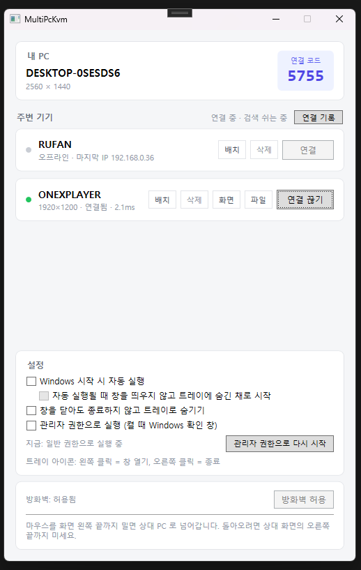
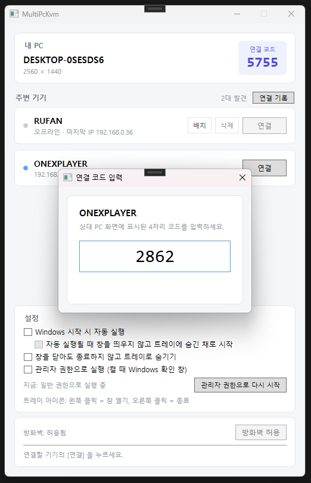
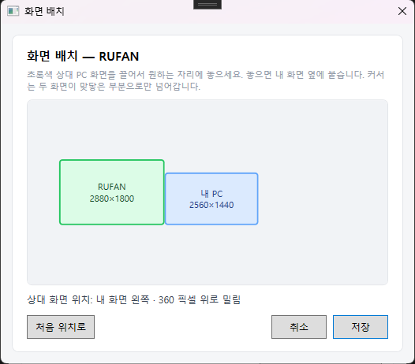
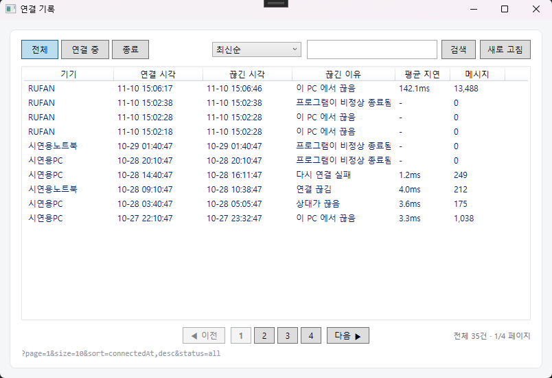
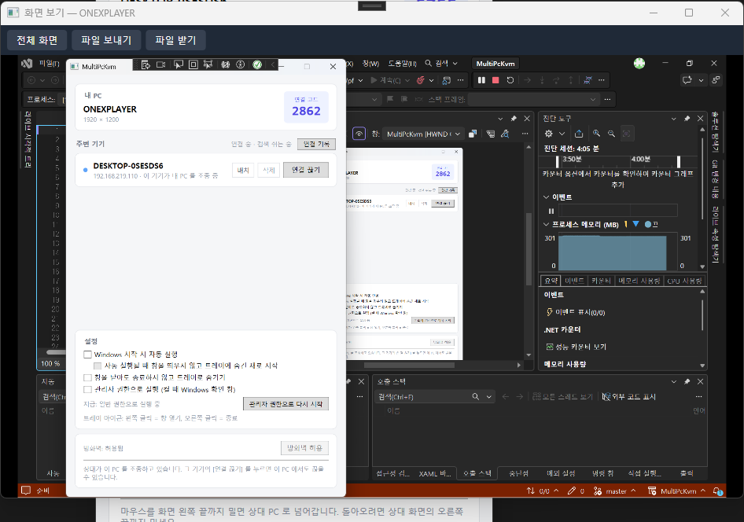

# Windows 멀티 PC 통합 제어 및 원격 프로그램 (MultiPcKvm)

2인 팀 프로젝트 (2026년 2학기). 아래 구조에서 "본인"은 이 저장소 주인, "팀원"은 함께 만든 팀원이다.

같은 네트워크(공유기·랜선 직결)에 있는 Windows PC 두 대를 키보드·마우스 하나로 조종한다.
커서를 화면 끝으로 밀면 상대 PC 로 넘어가고, 상대 화면을 창으로 보면서 조종하거나 파일을 주고받을 수 있다.

## 화면

| 메인 창 | 연결 코드 입력 |
|---|---|
|  |  |
| 주변 기기 목록. 연결되면 해상도와 지연 시간이 표시된다 | 처음 연결할 때 상대 PC 의 4자리 코드를 입력한다 |

| 화면 배치 | 연결 기록 |
|---|---|
|  |  |
| 상대 PC 화면을 끌어서 내 화면 옆에 놓는다 | 상태별 보기, 정렬, 검색 |

**화면 보기** — 상대 PC 화면을 창으로 보면서 조종한다.



## 프로젝트 구조

```
MultiPcKvm
├─ MultiPcKvm.Common     ← 둘이 같이 (고칠 때는 상대에게 먼저 말한다)
│   ├─ InputMessage / MessageType (주고받는 메시지 1~17)
│   ├─ 공통 인터페이스 (IInputCapture, IInputSender, ITransport)
│   ├─ 화면 보기 약속 (ScreenShare.cs: VideoFrame, IScreenViewer, IScreenSharer)
│   ├─ 파일 전송 약속 (FileTransfer.cs: IFileTransfer)
│   └─ 상수 (Constants.cs: 포트)
│
├─ MultiPcKvm.Network    ← 팀원
│   ├─ LAN 검색 (Broadcast + 망별 Broadcast + 같은 망 직접 탐색, 최근 기기 직접 확인)
│   ├─ TCP/UDP 전송
│   ├─ 연결 관리 (동시 연결·제3자 연결 처리)
│   ├─ 어댑터 지정 (LocalRoutes, 169.254 다중 어댑터)
│   └─ 기기 ID (DeviceIdentity)
│
├─ MultiPcKvm.Video      ← 팀원
│   ├─ 화면 보기 (ScreenSharer / ScreenViewer, 45002 TCP, GDI 캡처 + 바뀐 칸만 Deflate 압축)
│   └─ 파일 전송 (FileTransferEngine, 45003 TCP, 1MB 조각 · SHA-256 확인)
│
├─ MultiPcKvm.Windows    ← 본인
│   ├─ 키보드·마우스 후킹 (Low-Level Hook, 삼키기, 자동 복구)
│   └─ 입력 실행 (SendInput, 휠 포함)
│
├─ MultiPcKvm.App        ← 본인 (라이브러리)
│   ├─ 조종 세션 (KvmSession: 보내기·받기·연결 확인)
│   ├─ 커서 넘기기 (InputRouter, ScreenLayout: 화면 배치)
│   ├─ 저장된 기기 열쇠 (PairToken)
│   ├─ 받은 파일 이름 거르기 (ReceivedFileName)
│   └─ 로컬 DB (Storage: SQLite, 저장된 기기·배치·설정·연결 기록)
│
├─ MultiPcKvm.Tests      ← 본인 (저장소 검사, 배포에 안 들어감)
│   └─ DeviceRepository 검사 (임시 DB 에서 200·201·400·403·404·409·500 확인)
│
└─ MultiPcKvm.Wpf        ← 본인 (실행 프로그램)
    ├─ 메인 창 (기기 목록, 연결 코드 4자리, 화면 배치, 설정, 방화벽)
    ├─ 화면 보기 창 (전체 화면, 파일 보내기·받기)
    ├─ 트레이 · 자동 실행 · 관리자 권한
    ├─ 커서 숨기기 (상대 PC 로 넘어가 있는 동안)
    ├─ 진단 기록 (kvm-log.txt)
    └─ 삭제 (Uninstall.exe)
```

## 포트

| 포트 | 용도 |
|---|---|
| 45000 | 입력 (TCP·UDP) |
| 45001 | 검색 (UDP) |
| 45002 | 화면 (TCP) |
| 45003 | 파일 (TCP) |

프로그램의 [방화벽 허용] 버튼이 같은 망에서 오는 것만 열어 준다.

## 배포

1. VS 에서 `MultiPcKvm.Wpf` → 게시 → 폴더
2. 배포 모드 **자체 포함**, 대상 런타임 **win-x64**, **단일 파일은 끔**
3. 게시 폴더 이름은 **MultiPcKvm** (Uninstall.exe 가 이 이름일 때만 폴더를 통째로 지운다)
4. 받는 사람은 폴더를 풀고 `MultiPcKvm.Wpf.exe` 실행 → 처음 한 번 [방화벽 허용]

## 사용하면서 생기는 것

| 무엇 | 위치 |
|---|---|
| 진단 기록 `kvm-log.txt`, `kvm-log.old.txt` (최대 약 1MB씩 2개) | 프로그램 폴더 |
| 저장된 기기·설정 DB `kvm.db`, 이 PC ID `device-id.txt` | `%APPDATA%\MultiPcKvm` |
| 받은 파일 | `다운로드\MultiPcKvm` |
| 자동 실행 (설정했을 때) | 레지스트리 Run 값 또는 작업 스케줄러 `MultiPcKvm` |
| 방화벽 규칙 (버튼 눌렀을 때) | `MultiPcKvm (UDP)`, `MultiPcKvm (TCP)` |

프로그램 폴더의 `Uninstall.exe` 를 실행하면 위 것을 전부 지운다. (받은 파일은 물어보고 지운다)

## 검사

VS 에서 `MultiPcKvm.Tests` → [시작 프로젝트로 설정] → Ctrl+F5.
임시 폴더에 시험용 DB 를 만들어 검사하고 끝나면 지운다. (실제 `kvm.db` 는 건드리지 않는다)
마지막 줄에 `통과 n · 실패 0` 이 나오면 정상이다.

## 협업 규칙

- 서로 다른 프로젝트 폴더만 건드린다
- Common 을 고칠 때는 상대에게 먼저 말한다
- 작업 시작할 때 Pull, 뭐 하나 되면 Commit + Push
- 충돌이 나면 혼자 해결하지 말고 상의한다

## 개발 환경

- Windows 10 / 11
- .NET 10 (LTS)
- Visual Studio 2026
